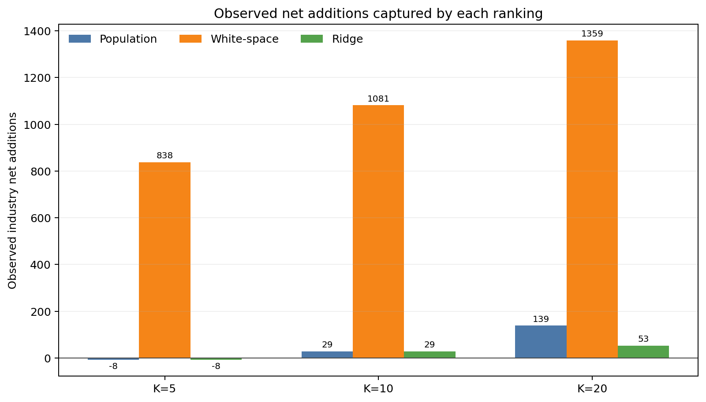
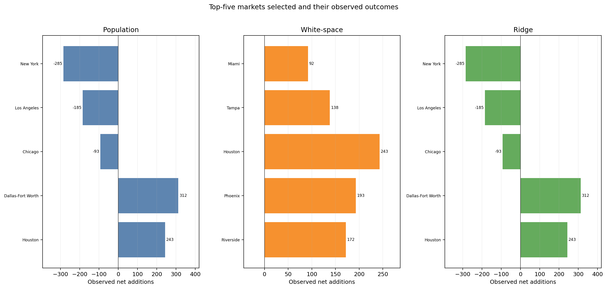

# Restaurant Market Expansion: Historical Metro Ranking Results

**Status: completed reproducible analysis, with documented data limitations.** The approved retrospective design compares a population baseline, a white-space score, and Ridge regression for choosing five US metropolitan markets from the 100 largest eligible MSAs by 2016 population. The target is industry-wide limited-service restaurant establishment net additions during 2018-2021. It is not a chain-specific return or profit measure.

## Recommendation

For this historical test, the white-space ranking is the strongest of the three methods. Its top five were Miami-Fort Lauderdale-West Palm Beach, Tampa-St. Petersburg-Clearwater, Houston-The Woodlands-Sugar Land, Phoenix-Mesa-Scottsdale, and Riverside-San Bernardino-Ontario. Together those markets recorded **838** net additions in 2018-2021, compared with **-8** for the population and Ridge top fives. White-space captured three of the hindsight top five, versus two for the other methods.

This supports white-space as the best ranking rule in this one retrospective evaluation. It does not establish that any of these markets would have generated positive results for a particular chain, nor that the same ranking would hold in another period.

## Design and data

| Stage | Information cutoff | Predictors | Label |
|---|---|---|---|
| Training | 2010-01-01 | CBP 2007 county establishment count (2002 NAICS 722211); PEP 2008 county population | CBP 2013 minus CBP 2010 establishments |
| Evaluation | 2018-02-01 | CBP 2015 county establishment count (2012 NAICS 722513); PEP 2016 county population | CBP 2021 MSA minus CBP 2018 MSA establishments |

Historical county observations are aggregated to the 2017 OMB Bulletin 17-01 MSA county assignments, using official Census List 1 filtered to metropolitan statistical areas. The crosswalk contains 383 US MSAs and 1,169 county assignments. The training set uses all 383 eligible MSAs; the evaluation shortlist is selected separately as the 100 largest by 2016 population, with CBSA code as the tie-breaker. All methods rank the same 100 candidates.

All 13 active official inputs are recorded with byte counts and SHA-256 hashes in `data/raw/download_manifest.csv`. The analytical panel contains 383 training rows and 100 evaluation rows (483 total) with no missing required values. Both evaluation endpoints are available for all 100 candidates. Source-level parsing and geographic checks are summarized in `outputs/feasibility.md` and `outputs/dataset_qa.json`.

The 2017 boundaries are applied retrospectively to historical county data. A county reference mismatch for Kalawao (FIPS 15005) in older CBP years was reconciled to the Maui (15009) reporting unit without duplicating or imputing restaurant counts. The List 1 directory metadata is dated 2018-01-23, before the 2018-02-01 cutoff, but this is not proof of its first publication date. The OMB List 2 workbook was retained as an audit artifact after inspection showed it contains principal cities, not county assignments.

## Methods

- **Population:** descending 2016 population.
- **White-space:** `population x national establishments per capita - current establishments`, where current restaurants are from CBP 2015 and national density is 0.000722278 establishments per person.
- **Ridge:** prespecified alpha 1.0; trained on 383 historical MSAs using population, current establishments, and restaurants per 10,000 residents. Imputation and scaling are fit on the training data only. Evaluation outcomes are not used to fit, tune, or select candidates.

## Top five and observed outcomes

| Rank | Population baseline | Net additions | White-space | Net additions | Ridge | Net additions |
|---:|---|---:|---|---:|---|---:|
| 1 | New York-Newark-Jersey City | -285 | Miami-Fort Lauderdale-West Palm Beach | 92 | New York-Newark-Jersey City | -285 |
| 2 | Los Angeles-Long Beach-Anaheim | -185 | Tampa-St. Petersburg-Clearwater | 138 | Los Angeles-Long Beach-Anaheim | -185 |
| 3 | Chicago-Naperville-Elgin | -93 | Houston-The Woodlands-Sugar Land | 243 | Chicago-Naperville-Elgin | -93 |
| 4 | Dallas-Fort Worth-Arlington | 312 | Phoenix-Mesa-Scottsdale | 193 | Dallas-Fort Worth-Arlington | 312 |
| 5 | Houston-The Woodlands-Sugar Land | 243 | Riverside-San Bernardino-Ontario | 172 | Houston-The Woodlands-Sugar Land | 243 |

The Ridge ranking exactly matches the population ordering in this run. Its top-5, top-10, and top-20 selected outcomes therefore match the population baseline; the very small difference in full-universe Spearman correlation does not produce a meaningful selection change.

## Evaluation results

“Hindsight best” is the sum of the five, ten, or twenty largest observed outcomes among the 100 candidates. It is only an evaluation reference. Regret is hindsight best minus the method's selected total. Precision@K is overlap with the observed-outcome top K divided by K. NDCG uses nonnegative linear relevance (`max(0, net additions)`).

| Method | K | Selected net additions | Hindsight best | Regret | Overlap | Precision@K | NDCG@K | Spearman rho |
|---|---:|---:|---:|---:|---:|---:|---:|---:|
| Population | 5 | -8 | 1,202 | 1,210 | 2 | 0.40 | 0.300 | -0.007 |
| White-space | 5 | 838 | 1,202 | 364 | 3 | 0.60 | 0.592 | 0.410 |
| Ridge | 5 | -8 | 1,202 | 1,210 | 2 | 0.40 | 0.300 | -0.000 |
| Population | 10 | 29 | 1,848 | 1,819 | 3 | 0.30 | 0.353 | -0.007 |
| White-space | 10 | 1,081 | 1,848 | 767 | 5 | 0.50 | 0.554 | 0.410 |
| Ridge | 10 | 29 | 1,848 | 1,819 | 3 | 0.30 | 0.353 | -0.000 |
| Population | 20 | 139 | 2,552 | 2,413 | 8 | 0.40 | 0.426 | -0.007 |
| White-space | 20 | 1,359 | 2,552 | 1,193 | 10 | 0.50 | 0.548 | 0.410 |
| Ridge | 20 | 53 | 2,552 | 2,499 | 8 | 0.40 | 0.424 | -0.000 |

Across K=5, 10, and 20, white-space captures substantially more observed net additions and has lower regret than the alternatives. For K=5, its selected total is 838 compared with hindsight's 1,202, a difference of 364. It still misses two hindsight top-five markets and should not be presented as an optimal or guaranteed selection.

## What drove the ranking differences

White-space penalizes existing restaurant supply relative to population. Miami (rank 8 by population, rank 1 by white-space) had 6.48 restaurants per 10,000 people; Tampa (population rank 18, white-space rank 2) had 5.79. In contrast, New York and Los Angeles had 8.55 and 8.28 restaurants per 10,000, respectively, placing them at white-space ranks 100 and 99. This describes the score construction and inputs; it does not establish why establishments later changed.

Ridge placed the same leading markets in the same order as population. Its predictions are a fitted function of population, current restaurant count, and restaurants per capita, but the rankings show that the model did not improve the top-five choice in this evaluation. No causal interpretation is warranted.

## Figures

The first chart compares captured net additions across K=5/10/20; the second shows each method's selected top-five markets and their observed outcomes. Values are establishment net additions, not store openings attributable to a chain.

## Limitations and decision boundary

- The outcome period includes COVID-19 and is one unusual historical test window.
- Net additions are industry-wide establishment counts, not chain-level openings, closures, sales, profitability, survival, or market share.
- OMB 2017 county boundaries are applied retrospectively; county reference-file checks are not historical polygon overlays.
- CBP omits post-2017 industry/geography cells below three establishments. Missing rows are unknown, not zero; the builder rejects any candidate missing either 2018 or 2021 outcome. For 2007/2010/2013/2015 CBP, establishment counts are published even when payroll is suppressed for small cells; where a target NAICS row is absent from those pre-2017 files, the builder explicitly treats that as no reported establishments. An explicit target row with missing `EST` is rejected. All selected candidates have both evaluation endpoint rows.
- The List 1 directory last-modified timestamp is not archival proof of first public availability. NAICS concordance workbooks are cited but not retained as separate raw files; the actual input files' target codes were inspected.
- This single evaluation has no confidence intervals or repeated time-period validation. The ranking may be unstable in other regimes.

The evidence answers the project question only within the defined historical proxy: white-space ranked best in this 2018-2021 test. It cannot establish that a chain should open in any specific market today. A live expansion decision would need chain-specific unit economics, current competition, real estate, labor, operating constraints, and a new current-data analysis.

## Reproduction and artifacts

Run `python -m src.fetch_data`, `python -m src.build_dataset`, then `python run_all.py --train-cutoff 2010-01-01 --evaluation-cutoff 2018-02-01`. The package also requires `python -m pytest -q`. Generated tables are in `outputs/tables/`; figures are in `outputs/figures/`. `outputs/tables/metric_definitions.csv` defines each metric.
